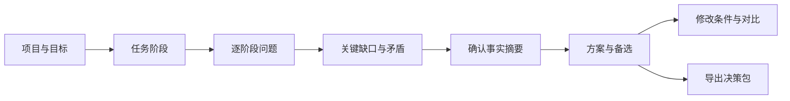

# Agent Architecture Composer 产品需求

[返回项目入口](../README.md) · [方法设计](methodology.md) · [技术方案](technical-design.md)

## 当前多需求问卷补充（2026-09-22）

可同时存在的行业、业务、入口、路径、并行、协作、检查、动作、已有架构、瓶颈、数据源、接入、时延与技术栈共 14 类使用多选。风险、数据边界与恢复能力按最严格条件单选，建设方式和首要取舍保持单选。问卷显示题型与多选计数；互斥项自动处理；最后一项取消后回到待明确。报告同时保留所有已选需求的影响，多路径和多语言有独立说明。旧会话可迁移，首版不要求新增证据或评分流程。

## 当前实施范围

2026-09-22，按用户最新要求先实现可用首版，简化证据、验证与测试。首版采用业务问答、可调整阶段、规则推荐、条件提醒、Markdown/JSON/Mermaid 导出及项目感知 Skill。完整证据评级、专家评测和实验回流延后；下文完整产品设计作为演进参考。

### 当前问卷体验

默认进入品牌首页，可开始自己的评估、继续当前方案、查看独立的示例报告，或从典型案例进入。问卷以自己的项目为主，案例仍可从折叠区选用。五组逐题问答收集业务背景、任务控制、系统数据、风险权限和交付运行，最后生成报告。支持自定义行业与业务描述、新建/升级分支、条件补问、未知答案、回退修改及会话导入导出。

用户无需先选择架构标签。报告解释为什么采用某种结构、需要组合哪些系统能力、哪些部分保留、如何迁移，以及当前能执行到什么范围。数据缺失、受限信息、硬实时要求和自动化目标冲突会体现在实施条件中。

本地 Web 的结构化回答驱动规则；文字描述保留背景，语义理解由配套 Skill 完成。问卷不会把未知事实当作已满足，也不会按行业名直接推荐框架。

## 1. 产品定位与成功标准

把业务任务和项目约束转化为可实施、可解释、可验证的架构选型方案。产品包含两个入口：无项目访问能力的 Web 问答工具，以及在学员已有系统中运行的项目感知 Skill。二者共享方法、事实模型、规则和报告结构。

这里的“最佳”定义为：在用户已确认的目标、硬约束、证据和维护能力下，给出当前最合适的推荐及接受的代价。多个候选无法区分时，输出条件性推荐和区分实验。信息不足时，仍交付已知结论、关键缺口与下一步，结论强度随证据变化。

首版成功标准：

1. 学员可以回答业务语言的问题，得到阶段级架构、控制权地图、模式组合、框架路线和实验计划。
2. 每项推荐都能追到输入事实、规则、课程依据、必要条件和反例。
3. Web 与 Skill 对相同标准化输入、规则版本、框架快照产生相同结构化决策。
4. 能输出传统确定性软件、LLM Feature、Workflow、Autonomous、Hybrid，以及保留现有实现、仅只读分析、暂缓实施等结果。
5. 首个发布版本同时交付可运行网页与可安装 Skill；二者可以分阶段开发，发布验收覆盖两端。

以下时间、题量和性能数字是设计目标，须经学员试用校准：典型 Web 首次评估 10—15 分钟；约 12 个公共问题加按阶段触发的补问；Skill 每轮优先询问 3—5 个高影响缺口。问题复杂时显示剩余缺口，不承诺固定题数必得完整方案。

## 2. 用户与场景

| 用户 | 起点 | 要完成的工作 | 核心输出 |
|---|---|---|---|
| 学员、应用开发者 | 一个业务想法 | 判断是否需要 Agent，选择最小充分结构 | 初始架构、适用条件、验证任务 |
| 现有系统维护者 | 已有代码和流程 | 找到应保留、封装、替换和补齐的部分 | 当前架构、目标架构、迁移步骤 |
| 技术负责人 | 多个候选或已有分歧 | 对齐硬约束、控制权与维护责任 | 候选对比、退出成本、ADR |
| 讲师 | DataAgent 等教学案例 | 改条件、观察方案变化、解释课程方法 | 决策差异和规则追踪 |

Web 用于课堂、立项和快速评审；Skill 用于已有系统的深入选型。Web 后续导出的会话可以交给 Skill 补充代码依据，Skill 导出的脱敏会话也可在 Web 中检查。导入必须由用户主动执行，Web 不自动扫描项目。

## 3. 产品范围

首版纳入：第 02 课 C01—C23 的方法覆盖；业务目标与阶段问答；现状与目标分离；适应性补问；候选筛选与组合；控制权与移交契约；规则解释；框架数据有效期；自研与复用取舍；最小实验；报告导出；离线下载；Skill 只读上下文采集。

后续扩展：LLM Runtime、Context、Capability、Memory、Eval 等专门选型模块，沿当前 V5 总纲和对应研究逐步加入。首版仅识别这些能力需求，避免把尚未整理的方法标为已覆盖。第 10、15、19、41 课可复用本产品，详细映射见 [交付管理](delivery-management.md)。

首版不包含自动改造项目、执行生产操作、运行真实框架性能竞赛、自动采购云服务、团队账户协作或付费 SaaS。框架实验输出为可执行的计划；只有另行运行并导入的实验才标为实测。

## 4. Web：从业务问答到方案

### 4.1 页面与流程

1. **项目与目标**：输入业务目标、已有系统状态、希望交付的结果。先选“信息或建议 / 审批或决策 / 真实执行 / 多阶段组合”，防止把建议与执行混为一体。
2. **任务阶段**：选择场景后提供可编辑的阶段草案。场景只预填提示，不替用户确认。自定义项目通过“输入 → 处理 → 检查 → 交付”向导创建阶段、依赖和失败出口。
3. **逐阶段问题**：询问路径、反馈、验证、风险与约束。每题提供例子、“为什么问”、不确定选项和可选备注。
4. **关键缺口**：聚焦会改变结论的问题，先消除矛盾，再判断放权条件和模式收益。
5. **事实确认**：显示用户回答、推导项、未知项、硬约束；让用户修正后生成报告。
6. **结果工作台**：当前首版使用带品牌水印的报告封面、推荐架构摘要与六段锚点目录，展开理由、系统能力、控制权、模式、框架与实施顺序；条件提醒与导出就近呈现。方法解释就近出现，不把术语学习设为答题前提。
7. **条件对比**：复制当前方案为假设分支；例如新增预算写入、切换语言、取消多 Agent。展示哪些事实、规则、节点和候选发生变化。
8. **保存与导出**：默认会话在内存中；用户可选择本地保存或导出，支持清除。离线包和在线网页保持同一规则版本。

### 4.2 必要问题与分支

| ID | 面向学员的问题 | 收集内容 | 对判断的影响 |
|---|---|---|---|
| Q01 | 完成后具体交付什么，谁判断合格？ | 目标、业务终态、验收主体 | 确定选型边界和完成条件 |
| Q02 | 当前怎样做，遇到的主要问题是什么？ | 新建或存量、基线、已发生失败 | 保留现状与复杂度收益 |
| Q03 | 能否用明确规则完成，需要模型理解什么？ | 确定性需求、语义需求 | 软件 / LLM Feature 候选 |
| Q04 | 可以提前写出所有步骤或出口吗？ | 路径稳定性、有限分支 | Chain、Router、Workflow |
| Q05 | 中间结果会改变下一步吗？举一例。 | 反馈依赖、路径变化 | ReAct、自主决策区间 |
| Q06 | 哪些步骤有依赖，哪些可以分开做？ | 阶段依赖、并行与共享状态 | Plan、Parallel、动态拆分 |
| Q07 | 用什么检查结果？失败后怎样修正？ | Verifier、独立证据、迭代价值 | Evaluator、Reflection、停止 |
| Q08 | 系统会读什么、改什么，错误后果是什么？ | 数据与操作范围、不可逆副作用 | 授权与执行边界 |
| Q09 | 谁批准动作，批准后参数还能改变吗？ | 授权对象、权限执行点、撤销 | 高风险执行门禁 |
| Q10 | 中断后要接着做吗，外部动作能否查回？ | 持久等待、恢复、幂等、对账 | Runtime 能力与部署需求 |
| Q11 | 哪些内容或权限必须隔离，谁合并结果？ | 上下文/权限隔离、责任归属 | Delegation 资格 |
| Q12 | 语言、部署、成本、时延和团队约束是什么？ | 技术栈、模型、规模、维护能力、优先级 | 框架与自研取舍 |

问题模板会按阶段复用。Q08 选“只读”时，不追问真实写入的补偿流程；选“待定”时，将执行架构标为待澄清。Q06 选择并行后继续问共享可变状态、结果合并者、部分失败与预算；Q10 确认跨日等待后追问状态所有者与恢复责任；Q11 请求多 Agent 后追问实际隔离需求和可验证收益。

### 4.3 追问、矛盾与退出

- 题目有四种回答语义：已知、未知、不适用、冲突待核实。未知值绝不转为最低分或默认通过。
- 一项控制能力分别记录“现有已验证 / 已实现未验证 / 仅计划 / 缺失 / 未知”，以及证据引用。目标中的审批能力不能冒充现状。
- 问题优先级依次为：业务范围冲突 → 权限与副作用 → 验收与停止 → 改变架构的任务特征 → 框架硬约束 → 偏好。
- 例如同一阶段同时被标为“只读”与“自动退款”，要求用户确认或拆分阶段；确认前不输出可实施的退款方案。
- 停止补问的条件：关键事实可判定，或用户选择“先看条件性方案”。轮次预算耗尽后保留未知与实验，不补造答案。
- 用户修改上游答案后，依赖该答案的派生事实、推荐和分支题失效并重算；旧回答保留在历史中，不隐式复活。

首版自由文本用于表达目标、例子和备注。决策依赖用户确认的结构化事实；不声称静态网页能理解任意长文。可选的联网 AI 辅助抽取属于后续增强，必须先让用户确认抽取结果，关键规则仍由共享内核执行。

## 5. Skill：先读系统，再问业务

### 5.1 工作过程

1. **界定任务**：识别用户指定项目根目录、评估范围、新建或改造目标；已有明确任务时直接开始。
2. **读取上下文**：先读取仓库入口、项目规则、架构文档、依赖声明、部署配置与有关模块，再按问题追踪控制流、状态和工具边界。只读源码不代表验证运行行为。
3. **形成事实包**：每项事实附路径、符号或行号、commit/文件哈希和观察方式；把文档声明、代码观察、用户确认与运行证据分开。
4. **展示现状摘要**：列出当前控制结构、可复用业务服务、状态所有者、已知约束与缺口。代码和文档冲突时保留双方，询问部署版本或实际行为。
5. **最少必要反问**：优先问代码无法回答的目标、流量、失败损失、授权要求、SLO、预算与维护人力。已经有可靠答案的问题允许确认或修正，避免整套问卷重来。
6. **执行共享决策**：把事实和回答提交给与 Web 相同的内核；按需再补一轮关键问题。
7. **生成改造方案**：明确保留哪些模块、在何处增加接口或验证、何时才替换框架，给出阶段迁移、回退方案和最小实验。
8. **输出决策包**：写入用户指定目录；未指定则在项目现有设计/ADR 位置中选择合适的新目录，遵守宿主项目规则，不覆盖既有报告。

Skill 使用宿主的模型与工具。下载 Skill 不等于本地离线推理；项目片段是否传输到模型服务取决于宿主配置。采集范围必须可查看、可收窄，不读取密钥、生产导出、个人数据、依赖缓存等无关内容，不通过运行项目脚本来“补齐上下文”。

### 5.2 兼容与退化

有文件读取与脚本执行能力的宿主采用完整模式：采集 → 澄清 → 运行内核 → 报告。仅有读取能力时可基于随包方法给出人工复核草案，明确标记 `manual-review`；此模式不宣称与 Web 的确定性结果一致。首个下载包只承诺经过安装与运行验收的宿主，其他宿主列为待验证。

## 6. 统一报告结构

完整方案包括以下章节，首屏另提供一页摘要：

| 章节 | 必须回答的问题 |
|---|---|
| 结论与适用边界 | 当前推荐是什么，哪些事实或条件仍待确认？ |
| 目标与现状 | 业务结果、现有架构、痛点、硬约束、证据边界是什么？ |
| 任务与控制权 | 每阶段谁选择、授权、执行、验证、停止和恢复？ |
| 架构与模式 | 顶层形态、四轴描述、模式组合、数据/控制流、必要契约是什么？ |
| 技术选型 | 自研薄主控、轻量 SDK、Graph、完整 Harness 各有什么条件、收益与代价？ |
| 备选与排除项 | 更简单、维持现状和其他可行方案为什么未选？何时应换？ |
| 实施与迁移 | 分阶段改什么、复用什么、依赖什么、失败怎样回退？ |
| 验证计划 | 同题实验、验收、真实/模拟证据、未测项是什么？ |
| 风险与重选 | 未知、未满足条件、预算、变更触发和负责人是什么？ |
| ADR 与来源 | 决策摘要、承担代价、事实/规则/课程/框架引用、版本是什么？ |

导出包设计：`report.md`（完整方案）、`adr.md`（一页决策记录）、`architecture.mmd`、`decision.json`（含事实快照和决策）、`session.json`（可续填会话）、`experiments.md`。它们从同一 Decision 对象生成。报告中的“待验证”与“已实测”必须明显区分。

证据状态采用“证据支持 / 条件成立后可用 / 信息不足”三类，附具体原因。置信百分比与综合架构总分不进入首版。用户排序偏好只在满足硬约束的候选之间生效。

## 7. 贯穿示例：同一 DataAgent 的三次判断

| 条件变化 | 预期结果 | 保持不变的要求 |
|---|---|---|
| 固定月报、维度固定、只读 | 确定性查询 + Workflow；解释节点可用 LLM Feature | 指标口径、授权查询、事实核验 |
| 每次异常不同、查询结果改变分析路径 | Autonomous-first Hybrid：Plan / ReAct / Replan，查询 Workflow-as-Tool；独立任务才并行 | 最终证据验收、预算与硬停止 |
| 新增预算写入、审批可能跨日 | 分开建议与执行；增加审批绑定、持久等待、幂等、对账；缺失能力列为实施前条件 | 分析主控可保留，写入必须独立受控 |
| 团队由 Python 改为 TypeScript | 重新筛选语言适配和现有组件，更新迁移成本 | 业务阶段、权限与完成语义 |

课程 DataAgent 的自研薄 Harness 是一条需要维护能力支撑的候选路线。用户已有可靠框架、定制需求少或维护人力不足时，可推荐保留框架或采用轻量 SDK。工具不把课程案例的实现选择变成所有项目的默认答案。

## 8. 功能优先级与验收

| ID | 优先级 | 用户故事 | 验收条件 |
|---|---|---|---|
| F01 | P0 | 我希望描述业务而不必先选术语 | Q01—Q12 可覆盖目标、阶段、风险与技术约束；支持未知和自定义阶段 |
| F02 | P0 | 我希望只回答关键缺口 | 分支问题有依赖；矛盾优先；改答案后旧派生结果失效 |
| F03 | P0 | 我希望知道理由和代价 | 每条推荐有事实、规则、条件、来源和至少一个合理备选或排除解释 |
| F04 | P0 | 我希望得到可实施方案 | 输出阶段控制权、模式与移交契约、技术路线、迁移及实验计划 |
| F05 | P0 | 我希望 Skill 理解现有项目 | 示例仓库可读出入口、状态、工具与依赖；不会将依赖名称直接当能力证据 |
| F06 | P0 | 我希望两端结果一致且可带走 | 同输入同快照的决策字段一致；Markdown / JSON / Mermaid 导出并可回读 |
| F07 | P0 | 我希望离线课堂可用 | 下载网页包断网可完成问答、报告、保存/导入；运行方式经发行验收 |
| F08 | P0 | 我希望推荐不会过时却无提示 | 每个框架能力带语言、版本、来源、验证日期、支持状态与维护责任 |
| F09 | P1 | 我希望知道变更为何影响方案 | 支持会话分支，逐条对比事实、规则和推荐差异 |
| F10 | P1 | 我希望将实验结果加入评审 | 导入结构化结果，区分实测、模拟与用户声明，重新生成 ADR |
| F11 | P2 | 我希望更自然地描述复杂项目 | 可选 AI 辅助抽取/解释，失败时静态问答仍可完成 |

## 9. 非功能要求与开放决策

- 默认 Web 无后端、无账户、无答题遥测，数据在当前浏览器处理；本地保存由用户选择，共享设备可一键清除。
- 网页适配桌面课堂和手机答题，题目可键盘完成，图表有文字等价表，状态不只靠颜色表达。
- 内核典型 50 阶段、500 规则的数据在普通教学电脑上计算目标为 1 秒内；以 M1 实测建立性能基线，当前无性能成绩。
- 框架能力“需要应用实现”必须写清承担方；缺失硬约束时不能通过排序权重抵消。
- 方法更新不会暗改已导出的报告。重新评估时显示方法版本与结论差异。

| 待定事项 | 当前提案 | 何时必须决定 |
|---|---|---|
| 分发许可 | 由课程负责人指定学员使用与再分发权利 | 首次对外发布前 |
| 首批 Skill 宿主 | 优先验收团队实际使用的 Codex 与 Claude Code；兼容声明以实测为准 | M2 验收前 |
| 网站发布地址 | 静态托管，域名与平台在上线时选择 | M3 发布前 |
| AI 增强与费用 | 首版无模型调用费用；Skill 使用宿主账户 | P2 启动时 |
| 全课程方法扩展 | 第 02 课完整覆盖，后续按已评审模块接入 | 对应课程方法整理后 |

以上事项不阻碍共享内核和双端原型设计。当前任务只形成规划与设计文档。
