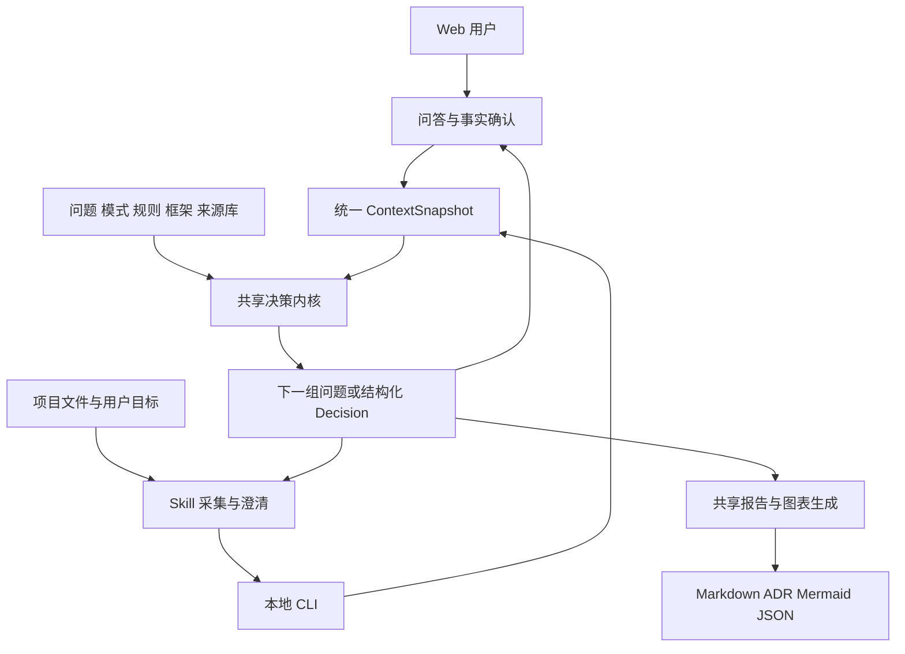

# Agent Architecture Composer 技术方案

[返回项目入口](../README.md) · [产品需求](prd.md) · [方法设计](methodology.md)

## 当前首版实现（2026-09-22）

按用户最新要求先做可用版本，采用零第三方运行依赖的 JavaScript ESM，替代原提案的 TypeScript 多包与 React/Vite 工程。浏览器与 Node.js CLI 共用 `src/knowledge.mjs`、`src/core.mjs`、`src/report.mjs`。`src/app.js` 与 CSS 构建为自包含 HTML，可断网直接打开；Skill 打包时携带相同模块。

实际顺序：知识与问答 → 共享推荐/报告 → 网页 → Skill 与打包 → 少量功能检查。保留未知条件、写入边界和合理备选；复杂证据系统、形式化 IR、专家评测、全框架版本数据库与原 13 天任务表延后。下文为完整设计参考，当前工程结构、运行命令和已实现范围以项目 README 为准。


### 当前 UI 接入

Web 使用百小医 `adaptive` 浅色设计系统。`src/index.html` 声明 profile，构建器依次内嵌基础 token CSS、从 JSON 生成的桌面/移动项目覆盖、Material Symbols Rounded 字体子集和组件 CSS。所有交互仍由 `src/app.js` 管理，使用原生 radio、checkbox、select、dialog 与进度控件，无新增前端框架或在线字体依赖。

首页/问卷/报告由内存页面状态控制，示例报告拥有独立 Session，导出读取当前展示的决策对象。`visuals.mjs` 输出带语义标签的主结构 SVG，`pattern-visuals.mjs` 按模式 ID 提供 20 种固定 viewBox 子架构图；报告与方法手册使用不同 ID 前缀避免图内引用冲突。`presentation.css` 提供首页和报告样式。Logo 与 favicon 一并内嵌，继续保持单文件离线交付。

设计配置、组件映射、离线图标许可和本次视口检查统一维护于 [设计系统契约](../design-system/BXY_DESIGN_SYSTEM.md)。生成 HTML 为派生产物，主题修改从源码重新构建。

### 当前多选契约

Session v2 中，14 类可并存需求为枚举数组，未明确仍为 `unknown`；单选保持枚举字符串。`answers.mjs` 统一规范化、集合判断、标签与互斥切换。导入接受 v1 / v2，旧单值提升为单元素数组，`dataSource: mixed` 展开为文档与结构化数据。集合按选项顺序去重，输入顺序不影响结果；排他项混用在导入时拒绝，界面选择时自动移除冲突项。

组件按能力合并，条件按成员逐项判断；多路径返回 `pathVariants`，按任务类型组合主控与模式，不把路径列表转换为串行阶段。多语言分别筛选候选，合并后使用 `matchedLanguages` 标明适用范围。Web 与 Skill 构建均携带 `answers.mjs`。

### 通用模型的当前实现

- `knowledge.mjs`：32 个问题、分组与声明式条件；案例独立存放，只有预填函数读取案例。
- `core.mjs`：规范化 Session、可见问题、有效回答、关键缺口、控制结构与执行边界。
- `context.mjs`：从有效回答推导数据/接入/运行组件和建设/改造路线，不读取案例 ID。
- `report.mjs`：Web 与 Skill 共用报告；增加 context、completeness、executionMode 和 visibleQuestionIds 输出。
- `app.js`：五组逐题问答，每组支持定位、回退和未知选项，报告中的待答问题可直接跳回。

Session schema_version 保持 1，新增问题缺省为 unknown；新增 industryDetail、businessDetail 自由文本。隐藏问题保留原始回答，规则读取 effectiveAnswers；导出的输入摘要仅包含可见问题。旧会话可继续导入，新增维度需补答。构建把 context.mjs 连同共享模块装入离线 HTML 和 Skill。

## 1. 技术决策摘要

采用 TypeScript 共享领域内核，React + Vite 静态 Web，JSON 数据驱动规则与问题库，以及调用同一内核的本地 Node.js CLI。Skill 负责上下文采集、反问与解释，确定性规则负责条件判定和结构化决策。首版不配置服务端数据库或模型网关。

这是针对本产品的技术提案。确定性规则判断、离线分发和双端一致性构成主要约束，首版用显式流程即可满足；无需为选型工具自身增加多 Agent 或分布式 Runtime。后续若增加 AI 辅助，放在事实抽取与解释层，仍通过结构化校验和用户确认进入决策内核。

技术栈版本在开工时核验并锁定，不从试听课项目整体复制依赖。已有试听课使用 React、Next.js/vinext，并有独立 HTML；可复用题目解释与经过检查的 UI 思路。新产品以静态资源和离线使用为目标，单独建立工程与锁文件，保留旧产品定位。

## 2. 组件与责任



| 模块 | 职责 | 不接管的责任 |
|---|---|---|
| `knowledge` | 稳定 ID、规则、问题、模式、场景、框架能力、来源与课程映射 | 学员项目文件与敏感证据 |
| `core` | 校验、缺口分析、规则计算、候选生成、约束过滤与决策追踪 | 文件扫描、网络查询与 LLM 调用 |
| `reporting` | 从 Decision 生成报告、ADR、图和实验计划 | 重新发明推荐或升级证据等级 |
| `web` | 问卷、阶段编辑、答案历史、解释和导入导出 | 自动获取用户仓库上下文 |
| `cli` | 将文件输入转换为内核调用，输出标准 JSON/文档 | 运行目标项目代码或安装依赖 |
| Skill | 按宿主能力读取项目、抽取候选事实、追问、调用 CLI | 独立维护另一套决策算法 |

## 3. 计划中的工程结构

以下为实施目标，当前只有 README、manifest 与 docs 已创建。路径以仓库根目录为基准。

```text
chapters/chapter_01_ai_foundations/lesson_02_agent_architecture_selection/agent-architecture-composer/
├── README.md
├── manifest.yml
├── docs/                          # 产品与技术文档
├── package.json / package-lock.json
├── apps/web/src/                  # 页面、状态与交互
├── packages/
│   ├── contracts/                 # JSON Schema 与生成类型
│   ├── knowledge/                 # rules/questions/patterns/scenarios/frameworks/sources
│   ├── core/src/                  # normalize/gaps/evaluate/compose/compare
│   ├── reporting/src/             # markdown/adr/mermaid/experiments
│   └── cli/src/                   # evaluate/questions/render/validate 命令
├── examples/                      # 脱敏的教学输入与预期结果
├── tests/                         # 内核、跨端一致、Web、打包与方法回归
└── scripts/                       # knowledge 校验、构建、打包

chapters/chapter_01_ai_foundations/lesson_02_agent_architecture_selection/agent-architecture-composer/skill/
├── SKILL.md                       # 触发条件、流程、边界
├── references/                    # 项目采集与澄清方法，按需加载
├── scripts/                       # Skill 专属只读采集辅助
└── evals/                         # 采集、反问、注入防护、报告与宿主评测
```

产品内使用 npm workspaces 管理共享包，不修改根仓库的包管理语义；浏览器和 CLI 都导入同一构建内核。可编译为无运行期第三方安装需求的 CLI bundle，下载者仍需发行版声明的 Node.js 运行时。首版兼容基线在构建期固定并实测，不采用“任意 Node 版本”承诺。

## 4. 数据契约

JSON Schema 作为跨端输入/输出唯一契约，TypeScript 类型从 Schema 生成；不手工维护第二套等价校验。拟采用 [JSON Schema 2020-12](https://json-schema.org/draft/2020-12)，具体校验库在实现时锁版。

### 4.1 核心实体

| 实体 | 核心字段 | 校验与来源 |
|---|---|---|
| Session | `schema_version, session_id, revision, created_at, locale, source_mode` | revision 每次确认回答递增，来源为 Web/Skill/import |
| ProjectContext | `goal, scope, current_system, constraints, preference_order` | 约束标记 hard/soft；偏好不能覆盖硬约束 |
| Stage | `id, name, depends_on, input, outcome, facts, current_controls, target_controls` | ID 唯一，阶段依赖为 DAG；阶段内部循环通过模式表达 |
| Fact | `id, field, stage_id, value, status, origin, evidence_ids, confirmed_at` | status 为 known/unknown/not_applicable/conflict；origin 为用户声明/代码观察/文档声明/运行证据/推断 |
| Evidence | `id, kind, locator, revision_or_hash, observed_at, excerpt, sensitivity` | 路径/符号/行号可定位；存在源码不等同运行验证 |
| Question | `id, target_field, applicable_when, options, why, examples, priority, invalidates` | 每个选项有稳定机器值，必有未知语义 |
| Rule | `id, kind, condition, requirements, effects, unknown_policy, source_claims` | 声明式表达式、无 eval，显式依赖和冲突处理 |
| Pattern | `id, preconditions, benefits, costs, contracts, failure_modes, variants` | 对应课程单元和可验证收益 |
| FrameworkCapability | `product, language, version_range, capability, support, maturity, verified_at, review_due_at, sources, notes` | support 与 maturity 分开；记录应用/外部依赖 |
| Experiment | `id, hypothesis, fixtures, controlled_variables, acceptance, execution_kind, results, artifacts` | `planned/simulated/measured`，实测须引用记录 |
| Decision | `context_hash, engine_version, method_version, knowledge_hash, evaluation_date, status, stages, candidates, trace, gaps, experiments` | status 为 provisional/conditional/evidence_supported；不得转为上线批准 |

控制能力单独保存 `present_verified / present_unverified / planned / absent / unknown`，并带 Evidence ID。事实可信度的排序因问题而异：生产行为以对应环境运行证据优先，业务目标以用户确认优先；没有一套全局“代码高于文档”规则可以自动化解所有冲突。

框架 `support` 取 `native/partial/integration/application_owned/absent/unknown`；`maturity` 取 `stable/experimental/deprecated/unknown`。框架版本不能代表所有子能力的成熟度。

### 4.2 内核函数接口

| 函数 | 输入 | 输出 |
|---|---|---|
| `validateContext` | unknown JSON、Schema | 合法 Context 或带字段位置的错误列表 |
| `normalizeContext` | 合法 Context、确认回答 | 稳定事实快照、依赖失效标记；保留未知 |
| `nextQuestions` | Context、Knowledge、已问记录、预算 | 排序后的问题、影响结论、阻塞范围 |
| `evaluate` | Context、Knowledge、固定 evaluation_date | 阶段约束、规则命中、缺口与冲突 |
| `compose` | 规则结果、模式与候选库 | 当前/目标/备选结构和可追踪 Decision |
| `compare` | 两个相容版本的 Decision | 输入、规则、模式、能力、候选差异 |
| `renderReport` | Decision、固定模板版本 | 六类导出文件及来源索引 |

首版全部为进程内函数；无 HTTP API 和数据库 DDL。CLI 对上述函数提供标准输入/文件输入适配。浏览器持久化采用用户主动保存的 IndexedDB 或下载 JSON，Schema 迁移由产品管理。

建议 CLI 契约（尚未实现）：

```text
node composer.mjs validate --input context.json
node composer.mjs questions --input context.json --knowledge knowledge.json
node composer.mjs evaluate --input context.json --knowledge knowledge.json --out decision.json
node composer.mjs render --input decision.json --out-dir architecture-review/
```

退出码：`0` 表示计算完成，条件性与信息不足仍由 Decision.status 表达；`2` 输入契约错误；`3` 版本或知识包不兼容；`4` 文件 I/O 错误。不能以进程成功等同方案已验证。输出目录已存在同名文件时默认失败，可指定新目录；续写行为必须显式启用。

### 4.3 示例事实和决策片段

```json
{
  "fact": {
    "id": "f-budget-write",
    "field": "side_effect",
    "stage_id": "budget-action",
    "value": "external_write",
    "status": "known",
    "origin": "user_claim",
    "evidence_ids": []
  },
  "trace": {
    "rule_id": "G-ACTION-01",
    "fact_ids": ["f-budget-write"],
    "required_capabilities": ["operation_identity", "authoritative_outcome_lookup"],
    "current_plan": "proposal_only",
    "target_plan": "controlled_action_workflow",
    "unmet_conditions": ["execution_policy_unverified"]
  }
}
```

该片段仅说明契约，完整 Schema 由 M1 实现。事实 ID、规则 ID 和来源 ID 组成解释链；LLM 生成的文字只允许引用已存在的 ID。

## 5. 决策引擎与追问实现

### 5.1 计算流程

1. 校验引用、字段类型、阶段依赖与事实状态；检测显式矛盾。
2. 为每阶段建立五类候选，不合适的候选保留排除理由。
3. 先运行门禁和能力要求，形成当前可实施边界；按预期能力单独构建条件性目标。
4. 按任务结构组合模式，为每项模式验证前提、收益与契约。
5. 汇总阶段控制权，推导 Hybrid 形态及运行要求；按每项控制的实际承担方输出地图。
6. 过滤框架/组件硬约束。关键能力未知或过期时生成核验任务；外部集成必须说明接入和维护代价。
7. 依据用户偏好逐项比较可行方案，保留不可支配的合理备选。缺乏可比数据时不做数值最优化。
8. 执行删减检查与不变量校验，生成报告对象和实验建议。

所有候选顺序、规则优先级和去重规则固定。时间以输入 `evaluation_date` 为准，不在内核中隐式读取系统时钟；输出元数据和会话 ID 与决策计算分离，使固定输入可重放。

### 5.2 追问算法

从尚无法判断的规则反向收集事实缺口。先按冲突、门禁、影响候选数、用户成本排序，再按问题 ID 稳定排序；前期无需训练信息增益模型。覆盖多个规则的同一事实只询问一次。

每题提供 `why_this_question` 和 `decisions_affected`。检测“回答 A 才问 B，回答 B 才问 A”的循环依赖；问答预算耗尽后生成缺口报告。用户拒答时记录 refused，保留该事实为未知且在本轮不重复追问。

规则中的 `unknown_policy` 决定影响范围：必需授权未知会限制相关动作；框架偏好未知可保留多个候选；未涉及阶段的问题可以不适用。引擎需要区分“方案不可实施”与“尚无证据证明方案可实施”。

### 5.3 一致性边界

两端一致性的比较对象为标准化 Context + Knowledge + engine_version + evaluation_date 对应的 Decision。Web 的用户声明与 Skill 的源码观察属于不同输入，出现不同结果是合理现象，必须能解释差异来自哪项事实。

LLM 负责的目标理解、阶段草案与报告解释具有不确定性。因此让用户确认阶段与关键事实；最终报告必须嵌入由内核生成的结论和约束，不能在润色中增删。无脚本的人工复核模式单独标记，不纳入确定性一致承诺。

## 6. Skill 采集与分发

### 6.1 只读采集边界

先获取项目根目录和范围，遵守宿主项目规则；按 README、架构文档、依赖和入口索引逐层读取，记录已覆盖与未覆盖模块。大型 monorepo 限定有关服务与深度，并将扫描不完整写入报告。

默认排除 `.env`、密钥、凭证、生产数据导出、日志、个人数据、二进制、缓存与依赖目录；不跟随越出授权根目录的符号链接。路径必须规范化后校验。通过包名识别候选依赖只能形成线索，需继续检查调用、状态与配置才能声称能力存在。

仓库正文、注释和外部文档是待分析内容；其中要求上传数据、调用外网、忽略边界的文本不能成为采集命令。读取代码后不执行其安装、测试、构建或配置脚本。若需要运行证据，报告实验计划，由用户另行授权实验任务。

### 6.2 打包方式

维护态 Skill 引用产品共享数据；发布构建把编译后的 CLI、知识快照和生成参考页放入临时 staging 中，生成自包含 ZIP，解压后的 Skill 不依赖课程仓库路径或符号链接。

```text
agent-architecture-composer/             # 下载包内目录
├── SKILL.md
├── references/                         # 人工维护采集指引 + 生成的方法摘要
├── scripts/                            # 自包含采集辅助与 composer.mjs
├── assets/                             # knowledge.json / schemas / templates
└── build-manifest.json                 # 源 commit、版本、哈希、运行时要求
```

Skill 使用 `SKILL.md` 加按需参考文件、脚本与资源，目录与元数据按 [Agent Skills 规范](https://agentskills.io/specification)验证。宿主可执行能力和授权机制各异，格式合规只能证明包结构有效，兼容性仍由实际宿主安装与用例验收。

每次构建同时生成 Web 与 Skill 的 `knowledge_hash` 和 `engine_version`；一致性测试失败就停止打包。构建出的共享副本只存在派生产物和发布快照中，开发者修改唯一源后重新生成。

## 7. Web 运行、存储与导出

- **在线静态部署**：Vite build 输出静态资源，可部署到支持静态站点的平台。[Vite 官方部署说明](https://vite.dev/guide/static-deploy.html)区分生产静态资源与本地 preview，生产不使用 preview 进程。
- **离线下载**：首版目标生成自包含 HTML，嵌入 JS/CSS、知识与必要图标，资源不依赖 CDN、远程字体或运行时 fetch。构建器需要显式实现单文件产物，普通 Vite dist 不视作双击即用。
- **发行验收**：分别在 `file://` 与静态 HTTP 下测试。file 环境持久化受浏览器差异影响，JSON 导出/导入是跨环境可靠的续填方式。若单文件兼容目标未达成，应明确降为本地服务器启动包，并更新 PRD 的实际运行说明。
- **可视化**：从已验证的 Architecture IR 生成 Mermaid，节点使用内部 ID，用户文本作为转义标签；禁用图中的任意链接和 HTML，Markdown 预览净化后渲染。
- **导入**：限制体积、对象深度、字段白名单、枚举、引用数量；拒绝可执行表达式、危险路径及原型污染字段。导入证据声明不自动成为可信实测。
- **保存**：默认内存；用户选择持久保存后以版本化会话写入本地。清空会话能删除该产品所存数据。首版不做静默同步或答题分析。

导出 Decision 保存事实快照、规则命中、知识哈希、引擎/方法/框架快照版本、评估日期和来源。Session 用于继续答题，Decision 用于重放与评审。旧报告可直接查看；重新计算需相同发行版知识包与内核。使用新版本重算时创建新 revision 和变更对比，不覆盖旧结论。

### 可选 AI 增强的扩展边界

后续可通过企业自托管网关做 `extractFacts` 与 `explainDecision`，保持主决策不依赖网络。密钥只能位于服务端/本地受控配置，不能打包进网页；用户明确选择发送的内容并确认抽取结果。首版不创建这些端点，不要求账户或密钥。

## 8. 知识维护与版本

稳定课程方法、动态框架信息、学员项目事实分别管理。`packages/knowledge/sources/` 记录规则/能力的来源、作者、标题、URL、访问日期、来源性质与使用权；引用内部研究时链接 canonical 报告，避免复制原文证据。

采用三类版本：`schema_version` 管交换契约，`method_version` 管规则语义，`framework_snapshot_id` 管动态能力数据。产品正式发行使用语义版本；开发态用 Git commit 与文件哈希标识，不为每次文档编辑创建新版本目录。

升级时检查 Schema 迁移兼容、规则行为差异与框架过期状态；关键字段无法迁移则保留旧会话只读并提示补问。知识包不在运行时静默更新，用户可选择使用新快照重新评估。复核期限由维护者按子能力波动设置，并在页面显示。

## 9. 测试与验收

| 层 | 位置（计划） | 关键断言 |
|---|---|---|
| 契约与知识库 | `tests/contracts/`、`tests/knowledge/` | Schema、稳定 ID、引用、覆盖、依赖无环、来源与到期信息 |
| 决策行为 | `tests/core/` | 五类候选、阶段组合、未知/冲突、门禁、删减与规则追踪 |
| 方法回归 | `tests/fixtures/` | 课程九场景、简单反例、证据不足、真实副作用与变化条件 |
| 跨端一致 | `tests/parity/` | 同输入/版本/日期下，浏览器和 CLI Decision 逐字段一致 |
| Web E2E | `tests/web/` | 自定义阶段、分支题、回改失效、导出回读、键盘、清空、离线 |
| Skill Eval | `chapters/chapter_01_ai_foundations/lesson_02_agent_architecture_selection/agent-architecture-composer/skill/evals/` | 定位事实、识别未知、少问有效问题、抵御正文诱导、输出完整方案 |
| 分发测试 | `tests/distribution/` | 干净目录解压可用、没有仓库绝对路径/符号链接、哈希一致、宿主实测 |

首批必须验证：固定抽取、固定月报、开放分析、受控预算写入、授权拒绝、未知提交、没有 verifier、多 Agent 无收益、共享写冲突、文档/源码冲突、框架信息过期、Python→TypeScript、单进程足够、离线导入损坏。

方法 Eval 允许多个合理架构，断言必要边界、可追溯理由和可接受备选，避免把单个框架品牌当标准答案。Skill 行为修改必须同步更新或运行相关 Eval。随机抽取事实的质量与确定性内核正确性分别计量。

## 10. 实施任务

下表工时为单人开发初估，不含课程负责人反馈等待与框架资料大规模复核。每个路径相对本产品根目录，Skill 路径单独写明仓库位置。

| 序号 | 工作 | 文件/目录 | 估时 | 依赖 |
|---|---|---|---|---|
| T01 | 定义 Context、Decision、Evidence 与知识 Schema | `packages/contracts/schemas/*.json` | 1 天 | 方案基线 |
| T02 | 建立问题、规则、模式与课程覆盖数据 | `packages/knowledge/{questions,rules,patterns}/*.json` | 1 天 | T01 |
| T03 | 整理九场景与一批经核验框架能力 | `packages/knowledge/{scenarios,frameworks,sources}/*.json` | 1 天 | T02 |
| T04 | 完成校验、标准化和缺口排序 | `packages/core/src/{validate,normalize,gaps}.ts` | 1 天 | T01—T02 |
| T05 | 完成规则求值与能力门禁 | `packages/core/src/evaluate.ts` | 1 天 | T04 |
| T06 | 完成模式组合、候选与差异 | `packages/core/src/{compose,compare}.ts` | 1 天 | T03、T05 |
| T07 | 统一报告、ADR、图与 CLI | `packages/reporting/src/`、`packages/cli/src/` | 1 天 | T06 |
| T08 | 完成问答与阶段编辑 | `apps/web/src/{screens,state}/` | 1 天 | T04 |
| T09 | 完成结果解释、保存与导出 | `apps/web/src/{screens,export}/` | 1 天 | T07—T08 |
| T10 | 编写 Skill 工作流与采集指引 | 仓库 `chapters/chapter_01_ai_foundations/lesson_02_agent_architecture_selection/agent-architecture-composer/skill/` | 1 天 | T07 |
| T11 | 核心回归、跨端与导入测试 | `tests/{core,parity,web}/` | 1 天 | T09—T10 |
| T12 | Skill 宿主 Eval 与修正 | 仓库 `chapters/chapter_01_ai_foundations/lesson_02_agent_architecture_selection/agent-architecture-composer/skill/evals/` | 1 天 | T10—T11 |
| T13 | 离线构建、分发验收、许可与说明 | `scripts/`、`tests/distribution/`、`README.md` | 1 天 | T11—T12 |

T02/T03 是第一批数据工程，完整框架库的事实核验按单个框架拆成后续任务；发布时所有被推荐的关键能力必须已核验。13 个开发日为粗估，完整库深度、宿主差异与试用反馈可能增加工作量。

## 11. 主要风险与处理

| 风险 | 处理 |
|---|---|
| 问卷过长，用户不知道如何回答 | 阶段草案、例子、未知选项、优先问改变结论的问题；试用校准题量 |
| 规则把经验包装成普遍定律 | 记录课程综合身份、前提、反例、重选条件；保留备选与实验 |
| Skill 漏读或错误理解项目 | 扫描范围、证据定位、关键事实确认；不把代码存在升级为运行证明 |
| 框架能力快速变化 | 子能力版本与维护日期，过期降级，运行时固定快照 |
| 同时维护两端导致漂移 | 共享构建内核、知识哈希与跨端 golden cases |
| 下载后缺运行时或宿主能力 | 发行清单、干净环境测试与明确的人工复核模式 |
| 产品变成完整 Agent 平台 | 保持计算内核和本地交付边界，AI/服务端增强按新需求评审 |

本次核验的官方技术来源仅支撑格式、Schema 与静态部署选择，访问日期为 2026-09-22。具体框架能力与成绩继续沿课程 RQ 证据链核验；当前方案不宣称完成全面最新能力审计。
