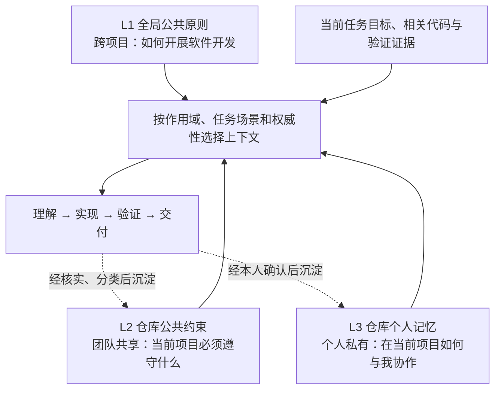

# AI Coding三级上下文工程方法论



三级上下文工程将稳定的工程原则、团队规范和个人偏好分开维护，在执行任务时按需组合。它解决长期协作中的重复解释、约束遗漏和经验流失问题；每次任务仍需补充具体目标、相关代码和验收依据。

**L1 提供默认方法，L2 明确项目约束，L3 调整个人协作方式。** 三个层级表达适用范围与共享边界，不构成简单的覆盖顺序。个人偏好须遵守团队强制约束；信息冲突时，核对来源、适用范围与时效，涉及业务承诺或权限的冲突应明确提出。

| 维度 | L1 全局公共原则 | L2 仓库公共约束 | L3 仓库个人记忆 |
|---|---|---|---|
| 适用范围 | 所有项目 | 当前仓库 | 个人在当前仓库的工作 |
| 核心内容 | 通用方法与工程原则 | 项目事实与团队规则 | 稳定偏好与协作习惯 |
| 维护者 | 个人或组织平台团队 | 仓库维护团队 | 开发者本人 |
| 更新时机 | 通用工作方法变化 | 项目事实、规范变化 | 本人表达或修订长期偏好 |
| 是否进入业务仓库 | 否 | 是 | 否 |

这里的“公共”指可复用或团队共享，不代表公开发布。三级模型是一种治理约定，文件是否被读取、何时生效，需要通过具体工具的入口与读取机制落实。

## L1：全局公共原则

沉淀跨项目、跨技术栈成立的工作方法，为 AI 建立稳定的工程行为基线。只保留能改变行动的原则，具体业务规则、技术栈和目录约定留给 L2。

| 内容类型 | 内容示例 |
|---|---|
| 需求与代码理解 | 明确预期行为；修改前阅读实现、调用方和相关测试 |
| 设计与复用 | 优先满足当前需求的简单方案；复用已有能力 |
| 变更边界 | 修改聚焦任务；保留无关改动；清理本次引入的无用代码 |
| 执行与排障 | 按复杂度拆解；先收集证据，再修复根因 |
| 验证与交付 | 用可观察的结果判断完成；如实报告未验证项 |
| 安全与授权 | 保护凭据；在授权范围内执行有外部副作用的操作 |

下面参考本目录的 [Karpathy 风格指令样例](karpathy-claude.md)，沿用“短原则 + 具体动作”的写法，补充代码调查、授权边界与验证证据。

```markdown
# AGENTS.md

跨项目的 AI Coding 工作原则。按任务复杂度裁剪执行步骤。

## 1. Think Before Coding

**先理解目标和现状，再动手。**

- 明确预期行为、约束和验收条件。
- 阅读相关实现、调用方和测试，能从仓库确认的信息先自行调查。
- 说明影响方案的关键假设；业务含义仍不明确时，提出具体问题。
- 有多种合理方案时，给出推荐和主要取舍。

## 2. Simplicity First

**用最少的必要复杂度解决当前问题。**

- 优先复用现有组件、接口和工程约定。
- 只实现当前需要的功能，避免为假设中的需求增加抽象与配置。
- 对真实的失败场景做好处理，满足已明确的安全与可靠性要求。
- 如果方案明显偏重，先检查是否存在更直接的实现。

## 3. Surgical Changes

**每一处修改都能说明与任务的关系。**

- 保持既有代码风格，保留用户的无关修改。
- 不顺带重构其他模块；发现关联问题时说明影响。
- 清理本次修改造成的无用导入、变量和函数。
- 不写入密钥；执行删除、发布或共享环境变更前核对授权范围。

## 4. Goal-Driven Execution

**定义成功条件，执行到验证完成。**

- 小型修复直接定位与验证；复杂任务拆成可独立检查的步骤。
- 修复故障时先复现或收集证据，验证修复覆盖了原始问题。
- 按改动风险运行相关检查，复用已有测试，补齐必要覆盖。
- 验证失败时调查原因并修复，不通过吞异常或削弱检查掩盖问题。
- 交付时说明改了什么、如何验证、还有什么未验证。
```

## L2：仓库公共约束

沉淀当前项目特有、团队共同认可的事实与约束，让 AI 知道改哪里、哪些行为必须保持、如何证明修改正确。重点记录局部代码难以推断的信息；入口保持精简，详细知识通过引用按需读取。

| 内容类型 | 内容示例 |
|---|---|
| 项目职责与技术栈 | 异步任务服务；API 与 Worker 独立部署 |
| 架构与模块边界 | API 通过 Scheduler 提交任务；领域层不依赖队列 SDK |
| 业务不变量 | 数据按租户隔离；同一幂等键不得重复创建任务 |
| 数据与接口契约 | 消息变更兼容旧消费者；金额统一使用分 |
| 开发与变更规则 | 客户端从契约生成；已发布迁移通过新迁移修订 |
| 验证与操作边界 | 调度修改须测重试和恢复；生产变更须有授权 |
| 知识导航 | 修改任务状态前读取生命周期文档 |

下面是一份虚构任务服务的完整示例。命令与路径仅展示写法，落地时应替换为仓库中已核实的入口。

```markdown
# AGENTS.md

本仓库提供多租户异步任务服务，负责提交、调度、执行和状态查询。
技术栈为 Python、PostgreSQL、Redis，版本与依赖以 pyproject.toml 和锁文件为准。

## 1. Know Where to Change

**沿既有边界修改。**

- src/api/：鉴权、参数校验和提交入口。
- src/services/：调度与业务逻辑。
- src/repositories/：数据库访问与租户过滤。
- src/workers/：任务执行；状态更新通过统一状态服务完成。
- API 不直接执行长任务，统一通过 Scheduler 提交。
- 外部 HTTP 调用使用 src/infra/http_client.py。

## 2. Preserve the Contracts

**租户隔离、幂等与兼容性必须保持。**

- 租户身份来自服务端鉴权上下文，不信任请求体提供的身份。
- 创建任务以 (tenant_id, request_id) 幂等，重复提交返回原任务。
- API 与 Worker 独立发布，队列消息必须兼容尚未升级的消费者。
- 已发布迁移保持不变；结构变更新增迁移，说明回滚或补偿方案。
- 不手动修改生成客户端，不在日志中输出令牌和敏感数据。
- 生产数据修改、部署和发布必须在当前任务授权范围内执行。

## 3. Verify the Change

**按变更类型提供验证证据。**

以下命令在仓库根目录执行：

- make install：安装开发依赖。
- make dev：启动本地服务。
- make check：代码检查、类型检查和单元测试。
- make test-integration：集成测试，需先启动本地 PostgreSQL 与 Redis。
- make test-contracts：API 与队列消息兼容性测试。

修改代码后运行 make check，并按范围追加：

- 调度、重试、取消或恢复：运行 make test-integration。
- API 或队列消息：运行 make test-contracts。
- 数据模型：在隔离数据库验证迁移及恢复方案。

报告实际执行的命令与结果；未执行的检查标明原因。

## 4. Read on Demand

**遇到相关任务，再读取详细规范。**

| 涉及内容 | 查阅入口 |
|---|---|
| 模块依赖与系统边界 | .my-ai-infra/references/architecture.md |
| 任务状态、重试与取消 | .my-ai-infra/references/task-lifecycle.md |
| 租户权限与数据隔离 | .my-ai-infra/references/tenant-isolation.md |
| 开发环境、测试与迁移 | .my-ai-infra/references/development.md |

规范、命令或契约变化时，同步维护对应文档与本文件入口。
当前需求与进度保留在任务文档中。
```

## L3：仓库个人记忆

沉淀本人在当前仓库中稳定、可执行的工作偏好，减少反复纠正。个人记忆保持私有，不改变团队规范，也不扩大操作授权。

| 内容类型 | 内容示例 |
|---|---|
| 方案取舍偏好 | 比较方案时先说明如何扩展已有 Scheduler |
| 开发节奏偏好 | 中大型需求先评审方案；局部低风险修复直接推进 |
| 验证关注点 | 调度变更的交付说明重点展示取消与恢复的验证结果 |
| 评审偏好 | 先讲正确性与可靠性，再讲可选改进 |
| 协作与表达偏好 | 先给推荐结论和取舍；完成后简述验证结果 |
| 经验形成的调查习惯 | 排查重复任务时优先检查租约日志，同时验证其他原因 |

**偏好说明“希望如何协作”，经验说明“曾观察到什么”。** 历史故障只能提供调查线索；可复核的项目事实应回到 L2 或故障文档。my-ai-infra 当前的记忆能力聚焦个人偏好，案例中的调查习惯只有经过本人确认才适合保存。

下面是可独立阅读的个人记忆示例，假定这些偏好均由本人明确确认。接入记忆工具时，须转换为其条目格式并填写真实来源。

```markdown
# Repository Personal Memory

范围：当前任务服务仓库。所有者：当前开发者。可见性：个人私有。
以下偏好在项目强制约束和当前明确要求内适用。

## 1. Design Preferences

**先给推荐方案和关键取舍。**

- 讨论调度架构时，先评估现有 Scheduler 的扩展能力。
- 引入新组件时，说明当前需求、已有能力缺口和维护成本。
- 中大型需求先完成方案评审，再进入实现；局部低风险修复直接推进。

## 2. Review Preferences

**把注意力放在影响交付的问题上。**

- 优先报告正确性、租户隔离、消息兼容性和故障恢复问题。
- 区分阻塞问题与可选改进，每项说明证据、影响和建议。
- 对风格差异沿用仓库约定，减少低收益的重构建议。

## 3. Investigation Preferences

**让历史经验帮助定位，让当前证据决定结论。**

- 排查重复任务时，优先查看租约续期日志、任务状态和幂等保护。
- 核对当前版本的调度机制，再判断历史排查路径是否仍适用。
- 调度变更的交付说明中，单独列出取消、重试和恢复的验证结果。

## 4. Collaboration Preferences

**先给结论，保留必要依据。**

- 方案说明先列推荐、依据与主要取舍，再展开细节。
- 能从代码和文档确认的问题自行调查，需要业务决策时集中提出。
- 交付简述修改范围、实际验证结果和待处理事项。
```

## 治理架构

### 存放规范

把 L1、L2、L3 对应到文件位置：个人库保存通用原则与个人偏好，业务仓库保存团队共享约束。

```text
~/.my-ai-infra/                       # 个人库，位于业务仓库之外
├── AGENTS.md                         # L1：全局公共原则（本文约定）
├── memory.md                         # 可选：跨项目个人偏好
└── projects/
    └── {projectId}/
        ├── PROJECT.md                # 项目身份与绑定信息
        └── memory.md                 # L3：当前项目的个人记忆

<repository>/                         # 业务仓库，团队共同维护
├── AGENTS.md → .agents/rules/AGENTS.md
├── .agents/
│   └── rules/
│       └── AGENTS.md                 # L2：项目规则正文与知识入口
├── .my-ai-infra.json                 # 记录 projectId，关联个人记忆
└── .my-ai-infra/
    └── references/                   # L2：详细资料（本文目录约定）
        ├── architecture.md           # 架构与模块边界
        └── development.md            # 开发与验证说明
```

L1 全局原则文件需另接入使用中的 Coding 工具；L2 详细资料可沿用已有 `docs/` 等目录，通过规则文件引用；L3 使用工具实际的 `memory.md`，对应前文的 `personal_memory.md` 示例。

### 上下文工程相关 Skill 案例

#### L2：整理仓库公共约束

入口：[my-init-repo-memory](https://github.com/shanggqm/my-ai-infra/blob/2812de77fc43df3f82ac4667c930462c42fd109e/assets/prompts/my-init-repo-memory.md) · Prompt。

> 用 my-init-repo-memory，依据当前仓库的代码、脚本和文档，更新 AGENTS.md，整理开发命令、业务约束和按需阅读入口。

读取仓库事实，精简或更新规则正文；已有软链接时维护 `.agents/rules/AGENTS.md` 并保留入口。后续任务可快速找到项目约束与相关资料。

#### L3：记住项目内的协作偏好

入口：[my-create-memory](https://github.com/shanggqm/my-ai-infra/blob/9c436d2ad920d9711f05776ea79b84b5cfd2c859/assets/skills/my-create-memory/SKILL.md) · Skill。

> 用 my-create-memory 记住：以后在这个项目讨论技术方案时，先给出满足当前验收的最小方案，再说明扩展选项。

按用户明确表达提炼偏好，去重后写入个人库 `projects/{projectId}/memory.md`，后续设计任务按场景读取；团队规范仍由 L2 维护。

#### 当前任务：收拢需求上下文

入口：[my-create-feature](https://github.com/shanggqm/my-ai-infra/blob/9c436d2ad920d9711f05776ea79b84b5cfd2c859/assets/skills/my-create-feature/SKILL.md) · Skill。

> 用 my-create-feature 新建“订单导出”（order-export）：让运营按日期导出订单，减少手工整理。将我提供并允许归档的需求说明和接口资料收进上下文包。

创建 `mai-specs/NNN-order-export/BRIEF.md` 与 `context/_INDEX.md`，归档素材、登记来源与阅读入口。任务资料随 Feature 维护，长期规则保持精简。

以上为调用示例，实际产出取决于项目与输入。目录和能力依据本地 my-ai-infra 工作区核对（2026-10-18）：[项目规则与装配](https://github.com/shanggqm/my-ai-infra/blob/9c436d2ad920d9711f05776ea79b84b5cfd2c859/docs/usage.md)、[个人记忆](https://github.com/shanggqm/my-ai-infra/blob/9c436d2ad920d9711f05776ea79b84b5cfd2c859/docs/memory.md)。
