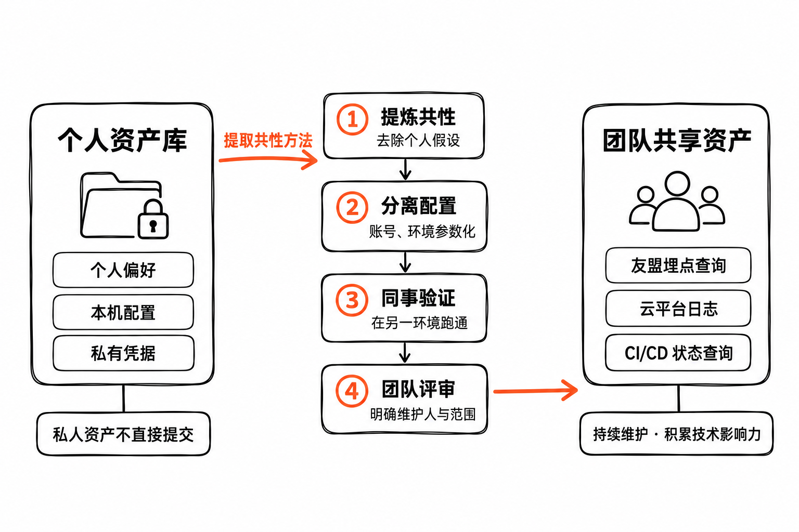

# 企业级 AI Coding：Skill 资产与治理方法论

企业级 AI Coding 的 Skill 建设分为两部分：梳理 MVP 资产清单，按四条治理经验持续维护。

# 一、Skill 资产体系：企业级 AI Coding 的 MVP 清单

清单按四类展示。**绿色：已有；橙色：待补齐。** 已有表示分发源或当前 Agent 环境提供，目标项目仍需确认可调用；待补齐包含已具备部分基础、需要企业适配的能力。

my-ai-infra 状态依据 2026-10-16 本地工作区的 [Skill 目录](https://github.com/shanggqm/my-ai-infra/blob/9c436d2ad920d9711f05776ea79b84b5cfd2c859/catalog/skills.json) 核对。Agent 基础能力按实际环境确认，`find-skills` 在本次会话中未列出，按待补齐标记。

## 1. SDD 交付流程

| 能力 | 入口 | 状态 |
|---|---|---|
| 需求上下文 | [my-create-feature](https://github.com/shanggqm/my-ai-infra/blob/9c436d2ad920d9711f05776ea79b84b5cfd2c859/assets/skills/my-create-feature/SKILL.md) | 已有 |
| 产品规格 | [my-create-prd](https://github.com/shanggqm/my-ai-infra/blob/9c436d2ad920d9711f05776ea79b84b5cfd2c859/assets/skills/my-create-prd/SKILL.md) | 已有 |
| 技术方案 | [my-create-design](https://github.com/shanggqm/my-ai-infra/blob/9c436d2ad920d9711f05776ea79b84b5cfd2c859/assets/skills/my-create-design/SKILL.md) | 已有 |
| 方案评审 | [my-review-design](https://github.com/shanggqm/my-ai-infra/blob/9c436d2ad920d9711f05776ea79b84b5cfd2c859/assets/skills/my-review-design/SKILL.md) | 已有 |
| 测试规划与验证 | [my-create-test-plan](https://github.com/shanggqm/my-ai-infra/blob/9c436d2ad920d9711f05776ea79b84b5cfd2c859/assets/skills/my-create-test-plan/SKILL.md) | 已有 |
| 编码实现 | [my-implement-code](https://github.com/shanggqm/my-ai-infra/blob/9c436d2ad920d9711f05776ea79b84b5cfd2c859/assets/skills/my-implement-code/SKILL.md) | 已有 |
| 代码评审 | [my-review-code](https://github.com/shanggqm/my-ai-infra/blob/9c436d2ad920d9711f05776ea79b84b5cfd2c859/assets/skills/my-review-code/SKILL.md) | 已有 |

## 2. 基础工具与开发辅助

| 能力 | 入口 | 状态 |
|---|---|---|
| 创建与改进 Skill | `skill-creator` · Agent 提供 | 已有 |
| 发现与检索 Skill | `find-skills` · 按宿主补齐 | 待补齐 |
| 隔离工作区 | [my-create-worktree](https://github.com/shanggqm/my-ai-infra/blob/9c436d2ad920d9711f05776ea79b84b5cfd2c859/assets/skills/my-create-worktree/SKILL.md) | 已有 |
| 长期偏好 | [my-create-memory](https://github.com/shanggqm/my-ai-infra/blob/9c436d2ad920d9711f05776ea79b84b5cfd2c859/assets/skills/my-create-memory/SKILL.md) | 已有 |
| AI 开发配置 | [my-ai-infra](https://github.com/shanggqm/my-ai-infra/blob/9c436d2ad920d9711f05776ea79b84b5cfd2c859/assets/skills/my-ai-infra/SKILL.md) | 已有 |

## 3. 业务、设计与系统理解

| 能力 | 补齐重点 | 状态 |
|---|---|---|
| 业务数据分析 | 指标口径与数据查询 | 待补齐 |
| 原型设计 | 设计系统与交互原型 | 待补齐 |
| 设计稿转代码 | 设计稿解析与组件映射 | 待补齐 |
| 仓库阅读理解 | 模块地图与关键调用链 | 待补齐 |
| 系统架构优化诊断 | 瓶颈分析与优化建议 | 待补齐 |

## 4. 运行、交付与上下文连接

| 能力 | 补齐重点 | 状态 |
|---|---|---|
| 上线告警分析与修复 | 日志、链路与恢复验证 | 待补齐 |
| CI/CD | 构建、部署与回滚 | 待补齐 |
| 上下文连接型 Skill | 友盟埋点、云厂商等平台 | 待补齐 |

---

# 二、Skill 治理：四条核心方法与经验

## 1. 不要拿来主义

**开源 Skill 先进入候选区，在自己的任务和环境里验证、适配，再进入正式资产库。** 名气、下载量和演示效果只能帮助发现候选；是否适合当前团队，要通过实际使用判断。

建议采用一条简短的准入路径：

**候选素材 → 审查 → 测试 → 调教与复测 → 正式入库。**

- **审查**：阅读指令、脚本、依赖和许可证，确认它会读取什么、修改什么、调用哪些外部服务。
- **测试**：选一个真实任务试跑，检查触发是否准确、步骤是否适用、产物是否满足要求。
- **调教**：针对实际失败补充项目路径、业务口径和工具约束；删去冲突、冗余或不适用的指令，再用原任务复测。
- **入库**：保留来源、版本、维护人和验证记录，让后续使用者知道适用范围与已知限制。

改造深度由差距决定。验证后已适用的内容可以直接复用；需要调整的内容优先做最小修改，控制长期维护成本。

**例子：**引入一个告警分析 Skill，先核对日志查询与外发行为，再用历史故障检查能否定位原因，补齐本团队的服务名、关联字段和恢复验证方法后入库。

## 2. Skill 贵精不贵多

### 多的问题

1. **选择混淆：Skill 语义重叠，模型容易选错**。例如 GitLab-helper 与 GitHub-helper 若描述和接口过于相似，同时配置又缺少明确边界，就容易造成选择混淆。
2. **治理失控：维护成本高，收益难评估**。重复规则、依赖与版本越多，问题越难定位；涉及工具和权限时，变更影响与风险也更难控制。
3. **推理成本高：试错链路变长，上下文负担增加**。无关 Skill、重复工具调用与大体量结果占用上下文，增加 Token 成本，也可能降低推理可靠性。

### 精的要义

1. **按场景定制：把开源 Skill 当素材**。围绕业务、产品、工具、权限和失败案例完成审查、测试与调教；依据实际差距决定定制深度，再纳入可用资产。
2. **分层与 MECE：能力、领域、场景各归其位**。Meta 层负责通用能力，Domain 层负责领域方法，Scenario 层负责任务闭环。按职责尽量互斥、覆盖所需能力，让触发入口边界清楚。
3. **上下文工程优化：渐进加载，只加入必要内容**。上下文窗口与注意力有限。先加载任务所需的入口，再按需读取资料；工具返回先筛选、摘要，避免大结果一次性挤满上下文。
4. **评估驱动：评测、bad case 与持续改进闭环**。用真实任务构建评估标准与基准案例，借助 AI 执行测试、分析失败案例并提出修改；复测后更新，让有效经验持续积累。

## 3. 分层治理：个人资产、全局入口与仓库共享资产

```text
# ① 个人资产库｜my-ai-infra 管理的个人源，留在业务仓库之外
~/.my-ai-infra/                         # my-ai-infra 默认个人库
└── assets/
    └── skills/                        # 个人 Skill 的维护源
        ├── my-create-prd/SKILL.md      # 内置 SDD Skill，可按需定制
        └── <personal-skill>/SKILL.md   # 自建、引入与调教后的个人资产

# ② 全局 Skill 入口｜跨项目可用，仍属于当前用户
~/.agents/
└── skills/                            # 用户级入口；mai setup 装配
    ├── my-create-prd/SKILL.md          # 从 my-ai-infra 个人库装配
    └── <global-skill>/SKILL.md         # 跨项目复用的通用能力
                                       # 全局安装不自动成为团队共享

# ③ 仓库级资产｜区分团队共享源与本地个人副本
<repository>/
├── .my-ai-infra.json                   # my-ai-infra 项目配置
└── .agents/
    └── skills/                        # 仓库级 Skill 入口
        ├── team-release/SKILL.md      # 团队共享示例：发布与回滚
        ├── team-cloud-logs/SKILL.md   # 团队共享示例：云日志查询
        └── my-create-prd/SKILL.md      # mai init / sync 装配的个人副本
                                       # 个人副本不直接提交业务仓库

# 维护关系：个人源 → 按需装配全局 / 项目入口；团队共享源 → 团队评审与维护
# 路径按默认配置示意；team-* 为建议示例，其他 Agent 入口按工具适配
# 同目录中的个人副本与共享资产分别管理 Git 跟踪，避免整目录误提交或误忽略
```

## 4. 私人资产不直接提交，共性能力整理后贡献团队



**个人定制留在个人资产库；能解决团队共同问题的能力，整理成独立的共享版本后再贡献。** 安装到本地项目目录的文件仍需判断归属，目录位置不能替代共享决策。

提交前检查暂存差异，避免把个人提示、个人偏好、绝对路径、账号配置和凭据带进业务仓库。需要忽略私人安装文件时采用本地排除规则，保留团队已跟踪资产；不对整个 Skill 目录一刀切忽略。

连接型共性 Skill 很适合作为贡献起点，例如友盟埋点查询、云平台日志查询、团队 CI/CD 状态查询。贡献前完成四件事：

1. **提炼共性**：保留共同任务与操作方法，去除个人偏好和只适用于自己机器的假设。
2. **分离配置**：把账号、环境与资源标识做成明确输入或配置，凭据交给实际运行环境管理。
3. **验证可复用性**：让另一位同事在自己的环境中完成代表性任务，补齐安装、权限和使用说明。
4. **通过团队评审**：确认维护人、适用范围和后续更新方式，再纳入共享资产。

**例子：**将“查询我自己的友盟项目”整理为“按指定应用、时间范围和事件口径查询数据”，由每位使用者配置自己的授权。把有效方法交给同事复用，并持续维护，可以积累技术影响力。

### 四份资产的归属

| 资产 | 放置位置 | 说明 |
|---|---|---|
| 我偏好的方案评审方式 | 个人资产库 | 个人偏好保留在个人库；需要跨项目使用时接入全局入口，不直接进入团队规范。 |
| 多个项目都会用到的通用工具 | 全局 Skill 入口 | 使用已验证版本，控制可见范围，去除单个项目的专有假设。 |
| 订单仓库的发布与日志查询方法 | 仓库级团队共享资产 | 由团队评审并跟随项目更新，保留本仓库的发布流程与查询约定。 |
| 从自己的友盟查询方法中提炼共性能力 | 整理后贡献团队 | 去除个人假设，分离应用、账号和环境配置；让同事验证后，经团队评审纳入共享资产。 |
